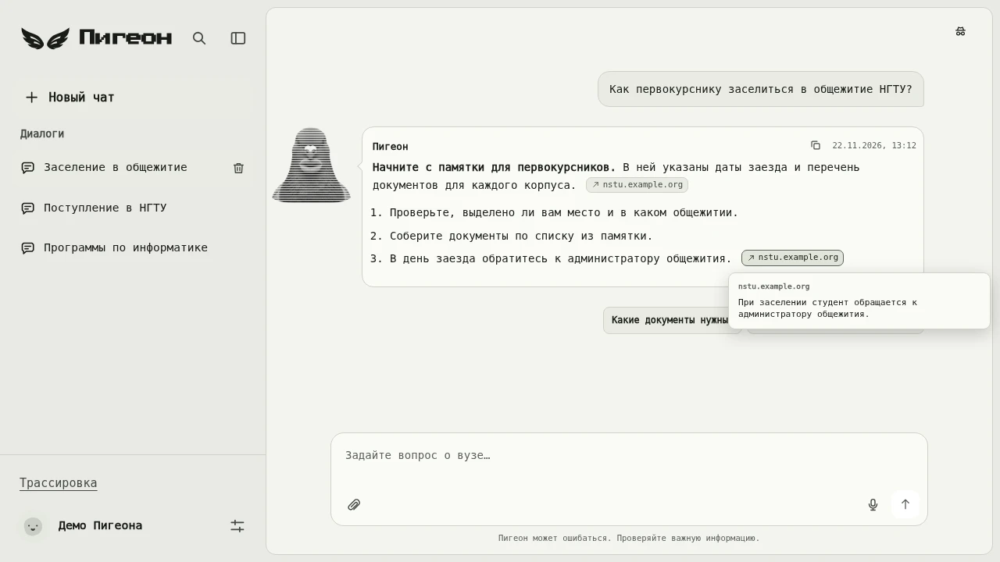

# Пигеон · NETI Next

**2-е место в треке ML Product хакатона «НЭТИ-НЕКСТ 2.0», ноябрь 2026.**

Пигеон помогает абитуриентам и студентам разобраться в поступлении, программах обучения, общежитиях и стипендиях. Он ищет открытые материалы вузов, учитывает уточнения в диалоге и даёт ответ с цитатами, которые можно сверить с оригиналом. Проект вырос из кейса НГТУ НЭТИ и принимает вопросы о вузах по всей России.

[Версия для сдачи](https://github.com/qubeyond/neti-next/releases/tag/submission-release) · [Кейс хакатона](docs/track.md) · [Результаты оценки](docs/metrics/eval-exa-context.md)

*Интерфейс чата с демонстрационными данными.*

## Возможности

- Отдельный контекст для каждого чата, настройки ответов в профиле и режим инкогнито.
- Цитаты с выдержками из источников и экспорт подтверждённых дат в календарь.
- Вопросы по PDF, изображениям и текстовым документам, голосовой ввод с редактируемой расшифровкой и предпросмотр вложений.
- Этапы обработки в чате и экран трассировки для демо-аккаунта с поиском, вызовами модели и проверкой доказательств.

## Локальный запуск

Из корня репозитория с Docker, Docker Compose и Make выполните `make -C deploy dev`. Команда создаст отсутствующие файлы окружения и поднимет приложение на `http://127.0.0.1:8080`.

Чтобы включить ответы с веб-поиском, укажите `WEB_ANSWERS_ENABLED=true` и `EXA_API_KEY` в `agent/.env`, а `ROUTERAI_API_KEY` в `inference/.env`, затем повторите команду запуска. Экран трассировки на `http://127.0.0.1:8080/trace-preview` в режиме разработки работает на тестовых данных без ключей. [Инструкция развёртывания](deploy/AGENTS.md)

## Как устроен проект

| Каталог | Назначение |
| --- | --- |
| [frontend](frontend) | Чаты, вложения, профиль и трассировка на React и TypeScript. |
| [backend](backend) | Go API для аккаунтов, диалогов и файлов. PostgreSQL для хранения, WebSocket для обновлений. |
| [agent](agent) | Python и FastAPI. Контекст диалога, веб-поиск, подготовка ответа и проверка цитат. |
| [inference](inference) | Внутренний сервис для вызовов языковых моделей и распознавания речи и текста. |
| [evals](evals) | Наборы вопросов, рубрики и инструменты сравнения версий агента. |
| [deploy](deploy) | Docker Compose, проверка стека и выпуск образов. |

[Спецификация](docs/spec.md) · [Архитектурные решения и контракты](docs/AGENTS.md)

## Оценка

В эксперименте на 54 вопросах и одной и той же выдаче Exa строгий зачёт получили 24 ответа с исходной подготовкой контекста и 28 с отбором релевантных выдержек. Для каждого варианта оценивали по одному ответу на вопрос. [Методика и результаты](docs/metrics/eval-exa-context.md)
